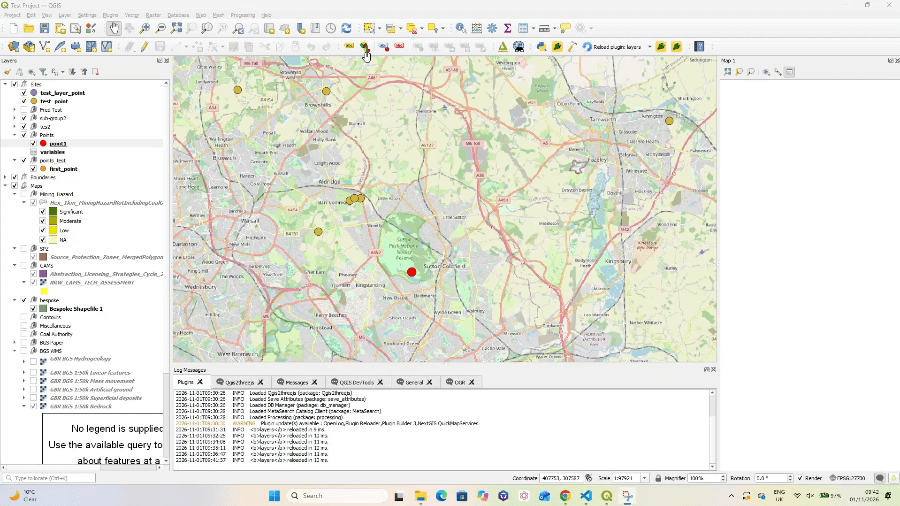

# QGIS Borehole Report Generator

A Python plugin for automatically generating borehole reports using geospatial data within QGIS.

## Overview

The plugin operates within QGIS, allowing users to select a borehole location directly from the map. It retrieves relevant information from the available geospatial layers and uses this data to populate a predefined Microsoft Word document `report_template.docx`.

## Demonstration

## How It Works

1. Select a point representing a borehole from the map in QGIS.
2. Retrieve data from multiple geospatial layers, including Shapefiles, GeoPackages and Web Map Service (WMS) layers, and store it in a Python dictionary.
3. Use the data stored in the dictionary to populate the Microsoft Word document.
4. Allow the user to choose where to save the report and what filename to give it.

## Technologies Used

- Python
- QGIS
- PyQGIS
- Microsoft Word

## Geospatial Data Sources

- Shapefile
- GeoPackage (GPKG)
- Web Map Service (WMS)

## Notes

This plugin is fully functional but remains under active development, with further improvements ongoing.

This plugin is proprietary software developed for Aquifer Energy. The company has given permission for the code to be publicly viewed.
